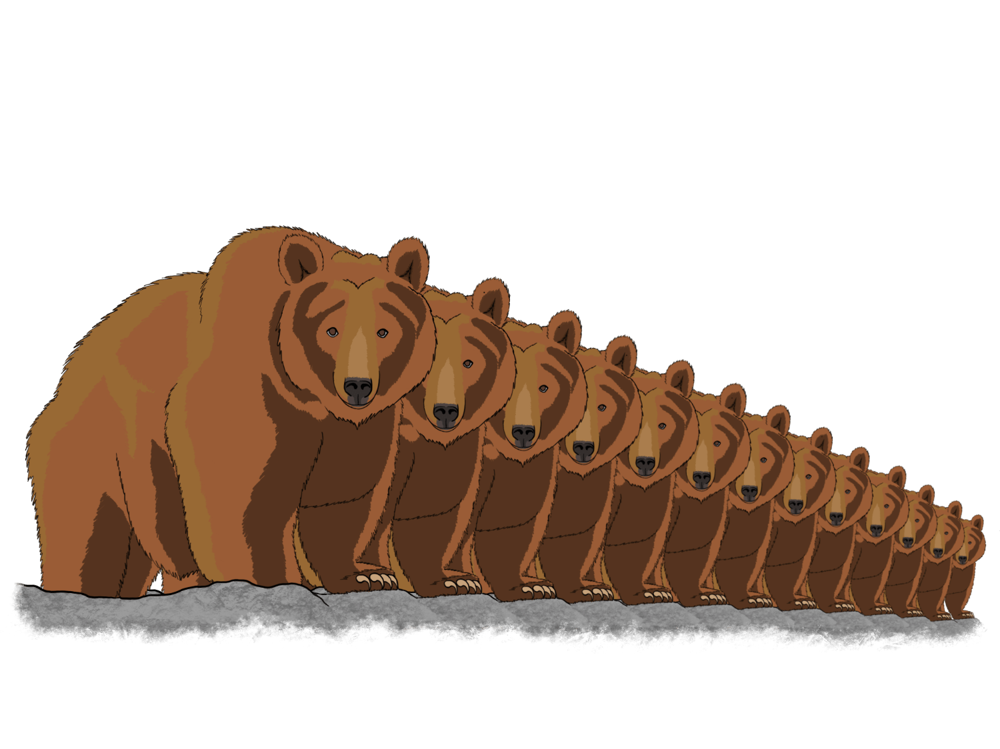

# October 25th, 2021 (Challenge 24)

# Bears Repeating
_Prompt: **Abomination**_ 
([original post](https://wavebirddash.tumblr.com/post/666028265720397824/030crc-october25-bears-repeating))

## Description

Just as we dare not speak the bear's true name for fear of summoning its wrath, there is a turn of phrase of equal power and danger that would be best avoided. It comes up innocently enough in casual conversation, when a point has been previously made and is reiterated for emphasis, but this simple statement is enough to draw the ire of a terrifying ursine threat from outside of time and space.

At first glance, the summoned bear appears similar to a normal brown bear, which would already be sufficiently alarming given its sudden appearance and immediate aggression. But its true nature is revealed to anyone foolish enough to engage it in combat without finishing it off. Similar to a hydra, slaying this particular bear will only cause one's problems to double, as two bears appear in its place to continue its rage and destruction. Each new bear shares the same magical properties of the original bear, and the threat is further compounded the more the bears are threatened.

Plainly put, this abomination poses significant a threat to all of existence. Bears ad infinitum will ravage the natural order, fell entire kingdoms, and clog the oceans with ever-replicating bear carcasses. Any attempt at countering this onslaught only further empowers it.

The dangers cannot be overstated. It certainly bears repeating that— oh no. What have I done? I've condemned us all! I hear it now! The heavy thuds of its feet shake the earth as it walks, its fangs gnash at the air as if preparing to clamp down on its prey, the terrible roars echo down the halls... it's already in the house... it's too late for me. Go! Release your damnable notes to the world, let the people know how I doomed us to destruction!

It's bears repeating!

It's bears repeating!

IT'S BEARS REPEATING!

<figure>
  
  <figcaption>Bears Repeating by <a href="https://tigerlilynoh.tumblr.com">TigerLilyNoh</a></figcaption>
</figure>

## Attributes

_Large Aberration, Chaotic Neutral_

**AC** 11 **Initiative** +1 (11) 
**HP** 22 (3d10 + 6) 
**Speed** 40 ft., Climb 30 ft.

|       |   | MOD | SAVE |       |   | MOD | SAVE |
|:-----:|:-:|:---:|:----:|:-----:|:-:|:---:|:----:|
|**STR**|17 | +3  |  +3  |**INT**| 2 | -4  |  -4  |
|**DEX**|12 | +1  |  +1  |**WIS**|13 | +1  |  +1  |
|**CON**|15 | +2  |  +2  |**CHA**| 7 | -2  |  -2  |

**Skills** Perception +1 plus PB 
**Immunities** Exhaustion 
**Senses** Darkvision 60 ft.; Passive Perception 11 plus PB 
**Languages** None 
**CR** 24 (62,000 XP;[^🐻] PB +1 for every Bears Repeating that exists in this world, minimum +2)

## Traits

_**Bears Repeating.**_ Once per world, when the barriers between planes are at their weakest, if someone speaks aloud the phrase "it bears repeating" in normal conversation, the bear is summoned from its hibernation in a pocket dimension and appears in an unoccupied space within 30 feet of its summoner. This bear is identical in appearance to a Brown Bear. Upon being summoned, it viciously attacks all non-bear creatures it can see and will not stop fighting until its summoner dies.

If the bear takes damage but isn't reduced to 0 Hit Points, it splits into two new Bears Repeating with full Hit Points and an unused Endure reaction. Each new bear shares the original bear's Initiative count and aggression, but it initially treats the creature that dealt the damage as its summoner. A bear will revert its aggression to the original summoner when its current summoner dies, or if its summoner is another bear.

_**Grin and Bear It.**_ When all Bears Repeating in a world are killed, the Bears Repeating gains a new body in its pocket dimension lair, reviving with all its Hit Points and resuming its hibernation, awaiting the day another world summons it. The bear can only be permanently destroyed if killed in its pocket dimension lair.

_**Keen Bearings.**_ The bear always knows the general direction of its summoner, as long as the two are on the same plane of existence.

## Actions

_**Multiattack.**_ The bear makes a number of attacks equal to its Proficiency Bonus, alternating between its Bite and its Claws for each attack.

_**Bite.**_ _Melee Attack Roll:_ +3 plus PB to hit, reach 5 ft. _Hit:_ 7 (1d8 + 3) Piercing damage.

_**Claws.**_ _Melee Attack Roll:_ +3 plus PB to hit, reach 5 ft. _Hit:_ 5 (1d4 + 3) Slashing damage. If the target is a Large or smaller creature, it has the Prone condition.

_**Spellcasting.**_ The bear casts one of the following spells, requiring no Material components and using Wisdom as the spellcasting ability (spell save DC 9 plus PB):

**1/Day Each:** _Gate_ (targeting its summoner)

## Reactions

_**Endure (1/Bear).**_ When the bear is reduced to 0 Hit Points, it drops to 1 Hit Point instead, after which it splits as per its Bears Repeating trait.

## Legendary Actions

_Legendary Action Uses: 3 (4 in Lair). Immediately after another creature's turn, the bear can expend a use to take one of the following actions. The bear regains all expended uses at the start of each of its turns._

_**Bear Arms.**_ The bear makes one Claws attack.

_**Bear Down.**_ The bear casts _Plane Shift_, using the same spellcasting ability as Spellcasting. The spell's target destination is an unoccupied space within 30 feet of its summoner. The spell fails if the bear and its summoner are on the same plane of existence. The bear can't take this action again until the start of its next turn.

---

| ⬅️ [October 24th: Outer Space](2021-10-24-outer-space.md) | [Home 🏡](index.md) | [October 26th: Secretive](2021-10-26-secretive.md) ➡️ |
|:-|:-:|-:|

---

[^🐻]: Challenge rating and XP are shared across all Bears Repeating in a single world, treating them as a single encounter for the purpose of calculating challenge and rewards. All Bears Repeating must be defeated for rewards to be distributed. If you choose to instead track individual bear XP, its stats are identical to a Brown Bear, so you can reward 200 XP per bear, then grant the remainder of the 62,000 XP pool when the final bear is defeated.
